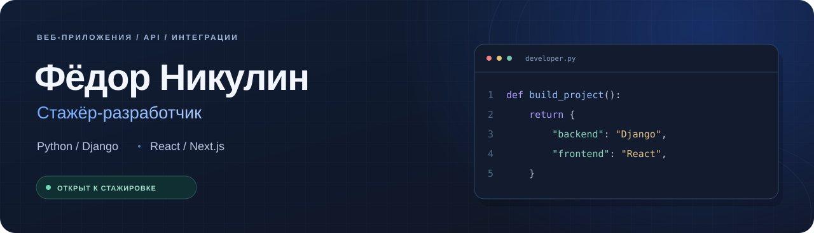
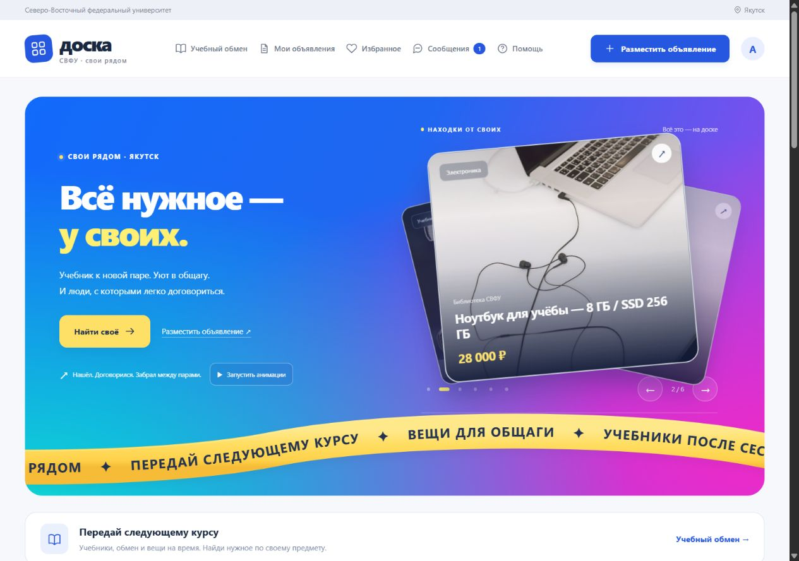
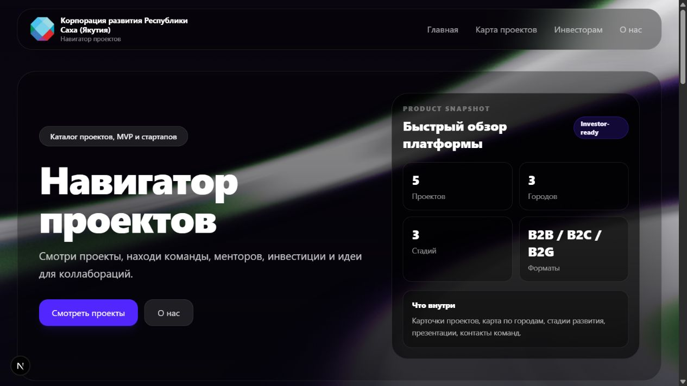

  

Студент **ИВТ СВФУ** из Якутска. Разрабатываю веб-приложения: проектирую данные и API, собираю интерфейс и подключаю внешние сервисы.

Летом 2026 года прошёл месячную **практику-стажировку в Корпорации развития Республики Саха (Якутия)**, где работал над каталогом проектов «Продукт Радар».

**Ищу стажировку в разработке**, где смогу работать над продуктом, разбирать задачи вместе с командой и расти через обратную связь по коду.

## Стек

**Backend** &nbsp; `Python` `Django` `Django REST Framework` `REST API` `JWT` 
**Frontend** &nbsp; `JavaScript` `TypeScript` `React` `Next.js` `HTML / CSS` `Tailwind CSS` 
**Данные и desktop** &nbsp; `SQL` `SQLite` `SQL Server` `C#` `WinForms` `Entity Framework` 
**Инструменты** &nbsp; `Git` `GitHub` `Postman` `VS Code` `Visual Studio`

## Проекты

### [ДоскаСВФУ](https://github.com/fedornikulin1/kursovaya)

**Университетский маркетплейс · проект для ВКР** 
`Python` `Django` `DRF` `SQLite` `JavaScript`

Объявления, фотографии, поиск, избранное, приватные диалоги, отзывы и поддержка. Студенческий сценарий — **учебный обмен**: запросы по предмету и семестру, подбор предложений, бронирование встреч в кампусе и возврат вещей.

- Общие бизнес-правила для сайта и REST API с JWT для будущего мобильного клиента.
- Проверки прав доступа и сценариев сделок; 76 тестов в опубликованной версии.
- Документация архитектуры, запуска и развёртывания.

[Код и запуск ↗](https://github.com/fedornikulin1/kursovaya) &nbsp; · &nbsp; [Учебный обмен](https://github.com/fedornikulin1/kursovaya/blob/main/docs/campus-exchange.md) &nbsp; · &nbsp; [API](https://github.com/fedornikulin1/kursovaya/blob/main/docs/api.md)

Локальная демонстрационная версия с тестовыми объявлениями.

### [Продукт Радар](https://github.com/fedornikulin1/product-radar/tree/backup/before-unchecked-main)

**Каталог проектов для Корпорации развития Якутии · практика и стажировка** 
`Next.js` `React` `TypeScript` `Tailwind CSS` `Битрикс24 REST API`

Витрина проектов, MVP и стартапов: поиск и фильтры, карточки, интерактивная карта Якутии, административная панель и CRUD проектов. Есть загрузка логотипов и презентаций.

Интеграция с **Битрикс24** создаёт и обновляет сделки и компании, сохраняет CRM ID, поддерживает экспорт и управляемый импорт проектов. В представленной версии данные сайта хранятся в JSON-файле.

[Посмотреть код ↗](https://github.com/fedornikulin1/product-radar/tree/backup/before-unchecked-main) &nbsp; · &nbsp; [Интеграция с Битрикс24](https://github.com/fedornikulin1/product-radar/blob/backup/before-unchecked-main/lib/bitrix24.ts)

  
Посмотреть интерфейс

   
  
   
  Локальная демонстрационная копия ветки backup/before-unchecked-main.

### [Учёт компьютерной техники ИМИ](https://github.com/fedornikulin1/projectBD)

**Desktop-приложение для учёта оборудования** 
`C#` `WinForms` `Entity Framework 6` `SQL Server LocalDB` `LINQ`

Реляционная БД из 11 таблиц, CRUD оборудования, учёт ремонтов и перемещений, поиск, отчёты Excel и генерация Word-документов. В мини-команде участвовал в разработке и распределении задач.

[Посмотреть код ↗](https://github.com/fedornikulin1/projectBD)

---

Информатика и вычислительная техника · СВФУ · обучение 2023–2027. Русский и якутский · английский B1.
